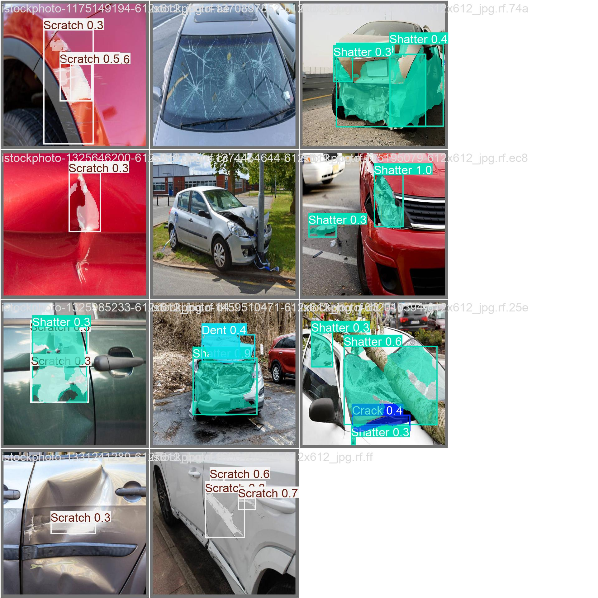
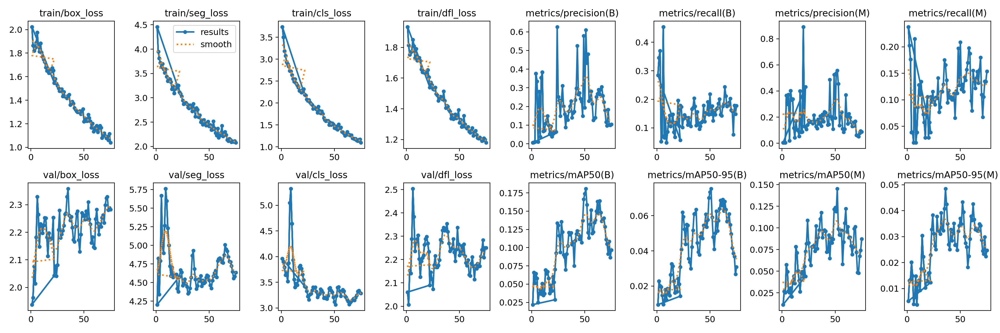

<div align="center">

# Automotive Anomaly Detection

**Instance segmentation of vehicle body damage (cracks, dents, scratches and shattered glass) using YOLOv8, built as a step toward fast, objective, automated car inspection.**


</div>

---

## Overview

Manual vehicle inspection for insurance claims, rentals and resale is slow, subjective and hard to scale. This project trains a **YOLOv8 instance-segmentation** model that locates damaged regions on a car image and produces a pixel-level mask and class label for each one.

<p align="center">
  
</p>

## Dataset

| Property  | Value                                                                                           |
| --------- | ----------------------------------------------------------------------------------------------- |
| Source    | [Car Crash Damage Detection on Roboflow Universe](https://universe.roboflow.com/alis-project/car-crash-damage-detection/dataset/1) (custom annotated) |
| Classes   | `Crack`, `Dent`, `Scratch`, `Shatter`                                                           |
| Split     | 108 train · 11 validation · 5 test images                                                       |
| Format    | YOLOv8 polygon segmentation                                                                     |
| License   | CC BY 4.0                                                                                       |

## Methodology

1. **Data**: images annotated with polygon masks and exported from Roboflow in YOLOv8 format
2. **Model**: `yolov8n-seg` pretrained on COCO, fine-tuned for 4 damage classes
3. **Training**: 640 px input, batch size 8, early stopping (patience 25), GPU auto-detection
4. **Evaluation**: precision, recall, mAP@0.5 and mAP@0.5:0.95 for both boxes and masks

## Results

Best validation metrics across the two experiments:

| Run                 | Epochs | Box mAP@0.5 | Box mAP@0.5:0.95 | Mask mAP@0.5 | Mask mAP@0.5:0.95 | Mask Precision |
| ------------------- | :----: | :---------: | :--------------: | :----------: | :---------------: | :------------: |
| `yolov8n-seg_e50`   | 50     | 0.160       | 0.084            | 0.139        | 0.042             | 0.633          |
| `yolov8n-seg_e100`  | 97\*   | 0.159       | 0.059            | 0.145        | 0.043             | 0.558          |

<sub>\* Early stopping triggered at epoch 97; best checkpoint at epoch 52.</sub>

Training curves, confusion matrices and PR curves for each run are in [`runs/car_damage_segmentation_v1/`](runs/car_damage_segmentation_v1/).

<p align="center">
  
</p>

### Analysis

Precision is reasonable, but recall is low. This is expected given the very small dataset (~120 images), class imbalance, and how small and subtle many scratches and cracks are. The results are a baseline, and the main levers for improvement are listed below.

## Getting Started

### Installation

```bash
git clone https://github.com/alihassan-9/Automotive-Anomaly-Detection.git
cd Automotive-Anomaly-Detection
pip install -r requirements.txt
```

### Training

The script downloads the dataset from Roboflow into `data/` and writes results to `runs/`.

```bash
export ROBOFLOW_API_KEY=your_api_key_here      # PowerShell: $env:ROBOFLOW_API_KEY="your_api_key_here"
python src/train.py
```

### Inference with the trained weights

```python
from ultralytics import YOLO

model = YOLO("runs/car_damage_segmentation_v1/yolov8n-seg.pt_e100_b8/weights/best.pt")
results = model.predict("path/to/car.jpg", save=True, conf=0.25)
```

## Project Structure

```
Automotive-Anomaly-Detection/
├── src/
│   └── train.py                         # dataset download + YOLOv8 training pipeline
├── data/
│   └── car-crash-damage-detection/      # Roboflow export (train / valid / test, data.yaml)
├── runs/
│   └── car_damage_segmentation_v1/      # training runs: weights, metrics, plots
├── docs/
│   └── report.md                        # project report outline
├── requirements.txt
└── README.md
```

## Future Work

- Expand and rebalance the dataset (more images per class, harder lighting and angles)
- Train larger backbones (`yolov8s-seg`, `yolov8m-seg`) and use stronger augmentation
- Tune the confidence threshold and use tiled inference for small defects
- Package the model behind a web demo or REST API for real-time inspection

## License

Code is released under the MIT License (see [`LICENSE`](LICENSE)). The dataset is licensed under CC BY 4.0.

## Author

**Ali Hassan** · [LinkedIn](https://www.linkedin.com/in/ali-hassan-70bb9323b) · [GitHub](https://github.com/alihassan-9)
